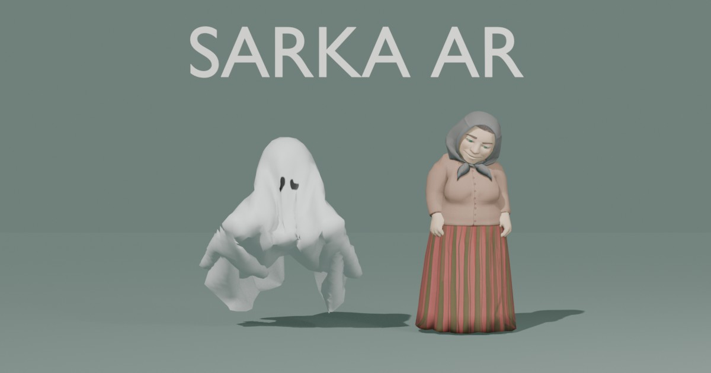

# Sarka AR

A WebAR prototype for Sarka: a recognised poster, painting or object (an electrical panel, an air purifier)
brings a creature into the room in front of your phone's camera.

**Try it:** https://warmishduck.github.io/SARKA/?scan — open it on a phone (on a desktop it
shows a QR code, because the camera tracking needs a phone).



## What's in it

- **Ghost** — the artist's test model with a baked cloth animation (Idle sways, Fly streams back while it moves).
- **Granny** — the artist's test model, rigged with Mixamo (its Idle clip is Mixamo's Thriller Idle).
- A **photo button** (camera feed plus creatures, ready to share), a **mute button**, a language switch
  (Finnish, English, Swedish) and a hint line. The sound effects are synthesized in the browser, so there are no audio files.
- Test exhibits, set in `src/content/exhibits.js` and opened with the object scanner (`/?scan`):
  - `/?scan` and `/?scan&c=test-granny-office`: the ghost or the granny on the abstract painting.
  - `/?scan&c=test-panel` and `/?scan&c=test-panel-granny`: at an electrical panel on a wall, with no poster. The
    creature comes out from behind the box and drops to the floor in front of it, below the phone's view
    (the hint asks the visitor to look at the floor).
  - `/?scan&c=test-purifier`: the ghost walks round an air purifier.
- The platformer level "Light the way" (an acorn and a Glowcap) and the other placeholder creatures were taken out
  of this project; a standalone copy of it as it was lives outside the repository.

## Exhibits and QR codes

The page shows different content depending on its address, so one site serves every QR code:

- `/?c=<code>` opens the AR view of that exhibit: the creatures that stand there.
- `/?scan` opens the object scanner (image targets, and with `c=` a chosen exhibit).
- `/` (no code, or a code that isn't recognised) opens the **welcome page**: no camera, just a 3D
  preview of the ghost and the granny standing together, and a line telling the visitor to scan the QR code
  next to an exhibit.

What each code shows is set in `src/content/`, not in code, so adding an exhibit copies nothing:

- `creatures.js` — the kinds of creature: which model, how tall, how it reacts to a tap.
- `exhibits.js` — one entry per code: which creatures stand there (and where), and which image target or object opens it.

To add a creature, put its `.glb` in `src/assets/` and add an entry to `creatures.js`; to add an exhibit,
add an entry to `exhibits.js`. Only the models of the exhibit being viewed are downloaded. A QR code only
holds the code (`https://<site>/?c=<code>`), so what stands at an exhibit can be changed without reprinting.
The exhibits there are test setups for the office, with the two creatures that exist so far.
`npm test` checks the config (every creature has its model, every exhibit is complete, the address parsing).

## Run it locally

```
npm install
npm run serve
```

Camera access needs HTTPS, so to try it on a phone, expose the dev server through a tunnel
(for example `ngrok http 5173`) and add the tunnel's domain to `server.allowedHosts` in
`vite.config.js`.

## Deploy

Pushing to `main` builds the site and publishes it to GitHub Pages
(`.github/workflows/deploy.yml`). To build by hand: `npm run build` (output in `dist/`).

## How it's put together

- `src/app.js` — the entry point: reads the address (`src/route.js`), then starts either the welcome
  page (`src/welcome.js`) or the 8th Wall camera pipeline for that exhibit.
- `src/threejs-scene-init.js` — the AR scene for one exhibit: taps,
  the photo button.
- `src/showcase.js` — loads and animates a set of creatures and makes them react to taps; used by
  both the AR scene and the welcome page. `src/lights.js` is the lighting they share.
- `src/content/` — the creatures and the exhibits (see above). `src/models.js` finds model files by name.
- `src/i18n.js` — the languages and the language switch's state; all on-screen text lives here.
- `src/rig.js`, `src/glow.js` — helpers: placing rigged characters, and the glow.
- `src/ui.js`, `src/index.css` — the AR view's loading note, hints,
  mute, language switch and photo.
- `src/sound.js` — the synthesized sound effects.
- `src/assets/` — the `.glb` models. Keep them small: they are downloaded by every visitor.

## Self-hosted engine

Camera tracking (world tracking / SLAM, plus the image targets of the object scanner) comes from
the 8th Wall **Distributed Engine Binary**. The hosted 8th Wall platform has been shut down; the
engine itself continues at [8thwall.org](https://8thwall.org). This project installs it from npm
(`@8thwall/engine-binary`, `@8thwall/xrextras`, `@8thwall/landing-page`, version `1.0.0`, pinned by
`package-lock.json`), and `vite-plugin-static-copy` copies each package's scripts and `resources/`
folder to `external/xr/`: the dev server serves them from memory, the build copies them into `dist/`
(see `engineFiles` in `vite.config.js`). The files are not in git. They are served from this site,
not from a CDN, so the site has **no third-party dependency at runtime** (important for a museum
with patchy Wi-Fi: once the engine scripts, about 7 MB, are cached, it keeps working).

- What gets copied: `xr.js`, `xr-slam.js` (the SLAM chunk, fetched lazily), `xrextras.js`,
  `landing-page.js`, and `resources/` (the fonts/icons/images `xrextras` and `landing-page` draw
  their UI from — the loading screen, the "open on your phone" QR fallback for desktop, etc). The
  copy also includes `xr-face.js` and the face resources, which nothing in `src/` uses.
- **Licence terms** (from the [distributed binary FAQ](https://8thwall.org/docs/migration/faq#distributed-engine-binary-license-and-permitted-use)):
  running/hosting it yourself and distributing it as part of this project is explicitly permitted;
  modifying, reverse-engineering, decompiling or redistributing an altered copy is not; Niantic
  Spatial's copyright notice must stay in the file, and this project must identify Niantic Spatial
  as the engine's creator and reference the licence — this section is that reference. **Never edit
  the copied engine files.** To update the engine, raise the versions of the three `@8thwall/*`
  packages in `package.json` and run `npm install`. The licence text ships with each package, as
  `node_modules/@8thwall/<package>/dist/LICENSE`.
- Started from 8th Wall's "three.js: World Effects" example.
- The ghost and the granny are test models made by the project's artist.
